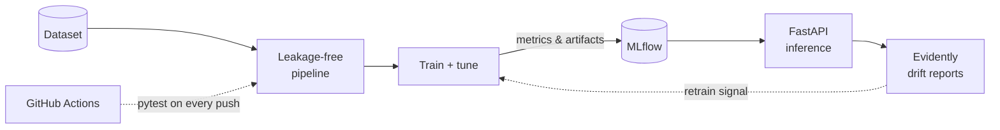
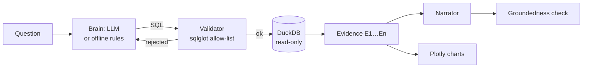
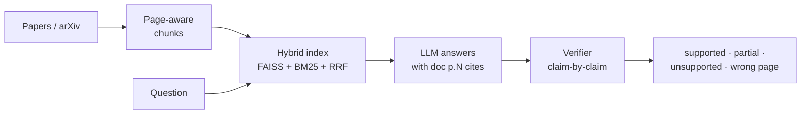

  
  
  
  

## ⚜️ The Status Window
About me

<b>📜 The recruiter's scroll (30-second summary)</b>

 

| | |
|---|---|
| **Role** | AI / ML Engineer · Data Scientist · ML Researcher |
| **Core strengths** | Predictive modelling, deep learning, statistical analysis, LLM systems (RAG and agents), MLOps |
| **What sets me apart** | I build ML that is *measurable and trustworthy*: tracked experiments, validated SQL, cited answers, drift monitoring and CI-tested pipelines |
| **Domains** | Healthcare AI (MRI analysis, Parkinson's screening), business analytics, research tooling |
| **Currently** | Building automated MLOps infrastructure and evidence-grounded LLM agents |
| **Looking for** | AI/ML engineering, data science and applied research roles, plus research collaborations |

## ⚔️ Cleared Gates
Featured projects · click a gate to enter the repo, open the scrolls below for the architecture

  
  

  
  

<b>🗡️ ModelForge: the MLOps forge</b>

 

A modular platform that trains, evaluates, versions, serves and monitors models, demonstrated on the Breast Cancer Wisconsin dataset.

- **Leakage-free data:** stratified splits, scalers fitted only on training data
- **Experiment tracking:** ROC-AUC / precision / recall logged and versioned in MLflow
- **Serving:** FastAPI with Pydantic validation and health probes, containerised with Docker
- **Monitoring:** automated Evidently AI data-drift reports

➡️ [Enter the gate](https://github.com/Shreyro/ModelForge)

<b>🔎 Data Detective: the analyst who never lies</b>

 

Ask a business question in plain English. The agent writes **validated** SQL, runs it read-only on DuckDB, draws charts, and checks every number in its explanation against the query output.

- **Two brains, one interface:** LLM-planned or deterministic offline mode, so CI needs no API key
- **Defence in depth:** SELECT-only, table allow-list, forced LIMIT, EXPLAIN bind-check, query timeout
- **Detective logic:** seasonally-adjusted anomaly detection that drills down to the root cause

➡️ [Enter the gate](https://github.com/Shreyro/Data_Detective)

<b>📖 PaperTrail: the archive that cites its sources</b>

 

Search research papers, ask questions and get **page-level citations**, with unsupported claims and wrong-page citations flagged.

- **Hallucinated-citation guard:** every cited page is checked against what was actually retrieved
- **Claim verification:** each sentence is judged against its cited page, with a verbatim quote check
- **Evaluation:** retrieval quality, answer correctness and citation accuracy on a gold test set

➡️ [Enter the gate](https://github.com/Shreyro/papertrail)

<b>🩺 Parkinson's detection: the healer's gate</b>

 

Two complementary approaches to early Parkinson's screening:

| Project | Approach | Repo |
|---|---|---|
| **MRI analysis** | Compares pretrained CNN architectures on MRI scans via transfer learning | [Parkinson-s-MRI-Analysis](https://github.com/Shreyro/Parkinson-s-MRI-Analysis) |
| **Spiral & wave test** | Classifies hand-drawn spirals/waves, served with an interactive Gradio interface | [Spiral-Wave-Parkinson-s](https://github.com/Shreyro/Spiral-Wave-Parkinson-s) |

<b>🗝️ Lesser dungeons: more projects</b>

 

| Project | What it is | Stack |
|---|---|---|
| [ShreyGPT](https://github.com/Shreyro/ShreyGPT) | Chatbot with an interactive interface | Python · LLMs |
| [NLP](https://github.com/Shreyro/NLP) | Collection of NLP projects | Jupyter · Transformers |
| [Machine-Vision](https://github.com/Shreyro/Machine-Vision) | Collection of computer-vision projects | Jupyter · OpenCV |
| [Spam-classification](https://github.com/Shreyro/Spam-classification) | Text classification for spam detection | scikit-learn |
| [portfolio-webpage](https://github.com/Shreyro/portfolio-webpage) | Personal portfolio site | HTML · CSS |

## 🔮 Skill Tree
Data science, AI and ML capabilities, each backed by a project

| Ability | What I do | Proof |
|---|---|---|
| 📊 **Data Science & Analytics** | EDA, statistical analysis, anomaly detection, KPI and root-cause analysis, dashboards | [Data Detective](https://github.com/Shreyro/Data_Detective) |
| 🧠 **Machine Learning** | Feature engineering, classification and regression, model comparison, leakage-free validation | [ModelForge](https://github.com/Shreyro/ModelForge) · [Spam-classification](https://github.com/Shreyro/Spam-classification) |
| 👁️ **Deep Learning & Vision** | CNNs, transfer learning, medical imaging, OpenCV | [Parkinson's MRI](https://github.com/Shreyro/Parkinson-s-MRI-Analysis) · [Machine-Vision](https://github.com/Shreyro/Machine-Vision) |
| ✨ **GenAI & LLMs** | RAG, hybrid retrieval, tool-using agents, LLM evaluation and grounding checks | [PaperTrail](https://github.com/Shreyro/papertrail) · [Data Detective](https://github.com/Shreyro/Data_Detective) |
| 💬 **NLP** | Text classification, embeddings, conversational interfaces | [NLP](https://github.com/Shreyro/NLP) · [ShreyGPT](https://github.com/Shreyro/ShreyGPT) |
| ⚙️ **MLOps & Engineering** | Experiment tracking, model serving, drift monitoring, Docker, CI/CD, testing | [ModelForge](https://github.com/Shreyro/ModelForge) |

## 🐉 The Rider's Armory
Tech stack

**🧠 ML & Deep Learning** 

**📊 Data & Analytics** 

**⚙️ MLOps & Backend** 

**☁️ Cloud** 

 

## 🏰 Training Grounds
GitHub activity

<picture>
  <source media="(prefers-color-scheme: dark)" srcset="https://raw.githubusercontent.com/Shreyro/Shreyro/output/github-contribution-grid-snake-dark.svg"/>
  <source media="(prefers-color-scheme: light)" srcset="https://raw.githubusercontent.com/Shreyro/Shreyro/output/github-contribution-grid-snake.svg"/>
  
</picture>

 

⚜️ Accept the quest: click it to message me on LinkedIn ⚜️

