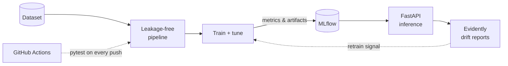
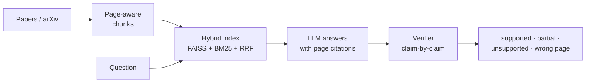

  
  
  
  

### About me

I'm an AI/ML engineer and data scientist who cares about the part after the notebook: making models **measurable, reproducible and trustworthy** once they meet real data. My work spans classical ML and statistics, deep learning for medical imaging, and LLM applications that cite their evidence.

- 🌸 **Currently:** building automated MLOps infrastructure and evidence-grounded LLM agents
- 🩺 **Research interest:** healthcare AI, including MRI-based Parkinson's detection
- 💬 **Open to:** AI/ML engineering, data science and applied research roles

### What I do

### Featured projects

Click a card to open the repository. Expand the sections below for architecture and details.

  
  

  
  

<b>ModelForge: how the MLOps pipeline fits together</b>

 

A modular platform that trains, evaluates, versions, serves and monitors models, demonstrated on the Breast Cancer Wisconsin dataset.

- **Leakage-free data:** stratified splits, scalers fitted only on training data
- **Experiment tracking:** ROC-AUC, precision and recall logged and versioned in MLflow
- **Serving:** FastAPI with Pydantic validation and health probes, containerised with Docker
- **Monitoring:** automated Evidently AI data-drift reports

<b>Data Detective: an analytics agent that shows its work</b>

 

Ask a business question in plain English. The agent writes **validated** SQL, runs it read-only on DuckDB, draws charts, and checks every number in its explanation against the query output.

- **Two modes, one interface:** LLM-planned or deterministic offline, so CI needs no API key
- **Defence in depth:** SELECT-only, table allow-list, forced LIMIT, EXPLAIN bind-check, query timeout
- **Root-cause analysis:** seasonally adjusted anomaly detection that drills down by channel and region

<b>PaperTrail: retrieval-augmented generation you can audit</b>

 

Search research papers, ask questions and get **page-level citations**, with unsupported claims and wrong-page citations flagged.

- **Hallucinated-citation guard:** every cited page is checked against what was actually retrieved
- **Claim verification:** each sentence is judged against its cited page, with a verbatim quote check
- **Evaluation:** retrieval quality, answer correctness and citation accuracy on a gold test set

<b>Parkinson's detection: MRI and spiral/wave analysis</b>

 

| Project | Approach |
|---|---|
| [MRI analysis](https://github.com/Shreyro/Parkinson-s-MRI-Analysis) | Compares pretrained CNN architectures on MRI scans using transfer learning |
| [Spiral & wave test](https://github.com/Shreyro/Spiral-Wave-Parkinson-s) | Classifies hand-drawn spirals and waves, served through an interactive Gradio app |

<b>More projects</b>

 

| Project | Description |
|---|---|
| [ShreyGPT](https://github.com/Shreyro/ShreyGPT) | Chatbot with an interactive interface |
| [NLP](https://github.com/Shreyro/NLP) | Natural language processing projects |
| [Machine-Vision](https://github.com/Shreyro/Machine-Vision) | Computer vision projects |
| [Spam-classification](https://github.com/Shreyro/Spam-classification) | Text classification for spam detection |

### Tech stack

<b>MACHINE LEARNING & AI</b> 

<b>DATA</b> 

<b>MLOPS & ENGINEERING</b> 

<b>CLOUD</b> 

 

### GitHub activity

<picture>
  <source media="(prefers-color-scheme: dark)" srcset="https://raw.githubusercontent.com/Shreyro/Shreyro/output/github-contribution-grid-snake-dark.svg"/>
  <source media="(prefers-color-scheme: light)" srcset="https://raw.githubusercontent.com/Shreyro/Shreyro/output/github-contribution-grid-snake.svg"/>
  
</picture>

  

