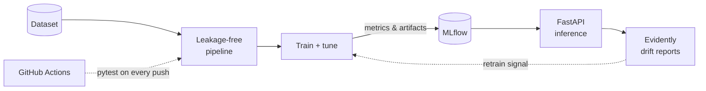
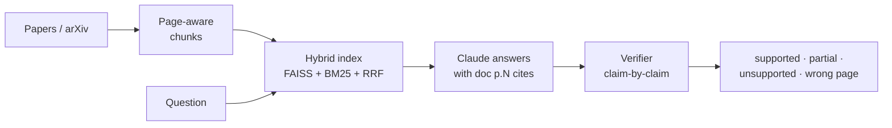

<div align="center">




<p>
  <a href="https://www.linkedin.com/in/shreya-roshan/"></a>
  <a href="https://github.com/Shreyro?tab=repositories"></a>
  <a href="https://github.com/Shreyro?tab=followers"></a>
  
</p>

</div>

## ✦ About me

<table>
<tr>
<td width="58%" valign="top">

```python
class ShreyaRoshan:
    role    = "AI Engineer & Researcher"
    focus   = ["ML", "MLOps", "GenAI", "Medical Computer Vision"]
    mission = "Bridge experimental ML and production-grade engineering"

    def now(self):
        return [
            "🔨 Building automated MLOps infrastructure",
            "🔎 Making LLM agents traceable & grounded",
            "🩺 Applying deep learning to healthcare",
        ]

    def open_to(self):
        return ["AI/ML engineering roles", "research collabs",
                "chats about production ML ☕"]
```

</td>
<td width="42%" valign="top">

**🎯 What I care about**

- 🧪 **Reproducibility.** Every experiment is tracked and versioned.
- 🛡️ **Guardrails.** Validated SQL, verified citations, drift alerts.
- 📏 **Measurement.** If it isn't evaluated, it isn't done.
- 🚢 **Shipping.** Docker, CI/CD, APIs, not just notebooks.

</td>
</tr>
</table>

## ✦ Featured projects

<p align="center"><sub>👆 Click any card to open the repo · expand the sections below for the details</sub></p>

<p align="center">
  <a href="https://github.com/Shreyro/ModelForge"></a>
  <a href="https://github.com/Shreyro/Data_Detective"></a>
</p>
<p align="center">
  <a href="https://github.com/Shreyro/papertrail"></a>
  <a href="https://github.com/Shreyro/Parkinson-s-MRI-Analysis"></a>
</p>

<details>
<summary><b>⚡ ModelForge: how the MLOps pipeline fits together</b></summary>
<br/>

A modular platform that trains, evaluates, versions, serves and monitors models, demonstrated on the Breast Cancer Wisconsin dataset.



- **Leakage-free data:** stratified splits, scalers fitted only on training data
- **Experiment tracking:** ROC-AUC / precision / recall logged and versioned in MLflow
- **Serving:** FastAPI with Pydantic validation and health-check probes, containerised with Docker
- **Monitoring:** automated Evidently AI data-drift reports

➡️ [View repo](https://github.com/Shreyro/ModelForge)
</details>

<details>
<summary><b>🔎 Data Detective: an analytics agent that shows its work</b></summary>
<br/>

Ask a business question in plain English. The agent writes **validated** SQL, runs it read-only on DuckDB, draws charts, and checks every number in its explanation against the query output.


- **Two brains, one interface:** works with Claude, or a deterministic offline brain, so CI needs no API key
- **Defence in depth:** SELECT-only, table allow-list, forced LIMIT, EXPLAIN bind-check, query timeout
- **Detective logic:** seasonally-adjusted anomaly detection that drills down to the root cause

➡️ [View repo](https://github.com/Shreyro/Data_Detective)
</details>

<details>
<summary><b>📄 PaperTrail: RAG you can audit</b></summary>
<br/>

Search research papers, ask questions and get **page-level citations**, with unsupported claims and wrong-page citations flagged.



- **Hallucinated-citation guard:** every cited page is checked against what was actually retrieved
- **Claim verification:** each sentence is judged against its cited page, with a verbatim quote check
- **Evaluation:** retrieval quality, answer correctness and citation accuracy on a gold test set

➡️ [View repo](https://github.com/Shreyro/papertrail)
</details>

<details>
<summary><b>🧠 Parkinson's detection: MRI + spiral/wave analysis</b></summary>
<br/>

Two complementary approaches to early Parkinson's screening:

| Project | Approach | Repo |
|---|---|---|
| **MRI analysis** | Compares pretrained CNN architectures on MRI scans via transfer learning | [Parkinson-s-MRI-Analysis](https://github.com/Shreyro/Parkinson-s-MRI-Analysis) |
| **Spiral & wave test** | Classifies hand-drawn spirals/waves, served with an interactive Gradio interface | [Spiral-Wave-Parkinson-s](https://github.com/Shreyro/Spiral-Wave-Parkinson-s) |

</details>

<details>
<summary><b>🗂️ More projects</b></summary>
<br/>

| Project | What it is | Stack |
|---|---|---|
| [ShreyGPT](https://github.com/Shreyro/ShreyGPT) | Chatbot with an interactive interface | Python · LLMs |
| [NLP](https://github.com/Shreyro/NLP) | Collection of NLP projects | Jupyter · Transformers |
| [Machine-Vision](https://github.com/Shreyro/Machine-Vision) | Collection of computer-vision projects | Jupyter · OpenCV |
| [Spam-classification](https://github.com/Shreyro/Spam-classification) | Text classification for spam detection | scikit-learn |
| [portfolio-webpage](https://github.com/Shreyro/portfolio-webpage) | Personal portfolio site | HTML · CSS |

</details>

## ✦ Tech stack

<div align="center">

**🤖 ML & AI**<br/>


**⚙️ Backend & MLOps**<br/>


**☁️ Cloud & Data**<br/>


**📊 Analytics & Web**<br/>


<br/>


</div>

## ✦ GitHub activity

<div align="center">


<picture>
  <source media="(prefers-color-scheme: dark)" srcset="https://raw.githubusercontent.com/Shreyro/Shreyro/output/github-contribution-grid-snake-dark.svg"/>
  <source media="(prefers-color-scheme: light)" srcset="https://raw.githubusercontent.com/Shreyro/Shreyro/output/github-contribution-grid-snake.svg"/>
  
</picture>

</div>

## ✦ Let's build something

<div align="center">

I'm open to **AI/ML engineering roles**, **research collaborations**, and conversations about **production ML**.

<a href="https://www.linkedin.com/in/shreya-roshan/"></a>
<a href="https://github.com/Shreyro"></a>


</div>
